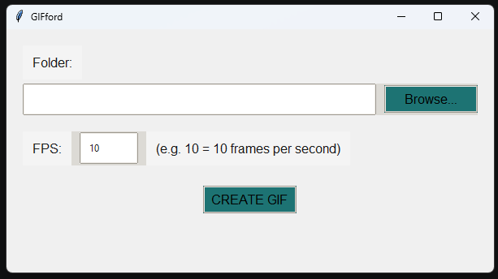

# GIFford
Convert .png's to GIF's via a UI interface

# Instructions

1. Run GIFord.exe
2. Copy the folder path which contains your png's (organised alphabetically) into the "Folder" input field or press browse to find it via your system explorer.
3. Set your desired GIF fps (unsure?, leave it at 10 and move up and down depending on the outcome)
4. press "Create GIF" to convert your png images into a GIF, the gif file will be created in the same directory locations as your png's with the name "animation.gif".